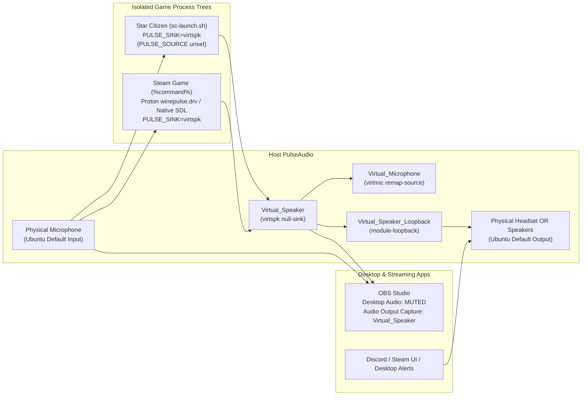

# 4. Audio Configuration, Virtual Cable Isolation & OBS Streaming Guide

This guide documents how audio routing works across **[`Virtual-Cables-Linux`](../../../README.md)**, **`renanmb/lug-wine-experimental`** (Star Citizen), and **Steam** (Proton & Native Linux games): how to isolate game audio onto a PulseAudio virtual cable (`Virtual_Speaker` / `virtspk`) for clean **OBS Studio** streaming and **Discord / Zoom** sharing while keeping in-game VOIP on your physical microphone, and how to listen on either **headphones** or **physical speakers** (with or without virtual cables active).

For the initial host investigation and per-window routing notes, see [`20261122_virtual_cable_wine_and_window_routing_handoff.md`](../notes/20261122_virtual_cable_wine_and_window_routing_handoff.md) and [`setup-virtual-cables`](../../../skills/user/setup-virtual-cables/SKILL.md) (synced with `lug-wine-experimental/.agents/references/docs/04_audio_isolation_and_obs_streaming_guide.md` and `lug-wine-experimental/.agents/references/notes/virtual_cable_audio_isolation_and_sc_launch_integration.md`).

---

## 1. Audio Architecture Overview

### Host, Wine & Steam Runner Stack (Ubuntu 22.04.5 LTS)
1. **Host Audio Server**:
   - Ubuntu 22.04.5 LTS runs **PulseAudio** (`pactl info` $\rightarrow$ `Server Name: pulseaudio`; `pipewire.service` is active only for Wayland screen-sharing portals while `pipewire-pulse` is inactive).
   - Virtual audio cables are managed on the host by [`virtual-cables-pulseaudio.sh`](../../../virtual-cables-pulseaudio.sh) (`/home/tarfy/Documents/GitHub/renanmb/Virtual-Cables-Linux/virtual-cables-pulseaudio.sh`). *(Systems running PipeWire audio use [`virtual-cable-pipewire.sh`](../../../virtual-cable-pipewire.sh) instead.)*
2. **LUG Wine Runner Audio Backend (`lug-wine-experimental` `11.22-2+`)**:
   - Windows audio APIs (`mmdevapi.dll`) call into `lib/wine/x86_64-unix/winepulse.so`, dynamically linked against host `/lib/x86_64-linux-gnu/libpulse.so.0` (GLIBC 2.35).
   - Prefix audio endpoints are tracked under `[Software\\Wine\\Drivers\\winepulse.drv\\devices\\...]` in `/home/tarfy/Games/star-citizen/user.reg`.
   - No Wine recompilation is required to turn virtual-cable routing on or off—routing is controlled per process at launch via `PULSE_SINK`.
3. **Steam Game Audio Backends (Proton & Native Linux)**:
   - **Proton games** use Valve's `winepulse.drv` (`libpulse`), behaving identically to `lug-wine-experimental`.
   - **Native Linux games** (SDL2, FMOD, OpenAL, Unity, Unreal) connect to PulseAudio directly or inside Valve's `pressure-vessel` (`SteamLinuxRuntime_sniper` / `soldier`) container, which bind-mounts the host PulseAudio socket (`$XDG_RUNTIME_DIR/pulse/native`) and honors `PULSE_SINK=virtspk`.

### End-to-End Signal Flow



### Why `PULSE_SINK=virtspk` Beats Manual `pavucontrol` Routing
- **Prevents Wine/Proton cross-contamination**: PulseAudio's `module-stream-restore` remembers per-application sink assignments using generic loader binary names (such as `wine64-preloader`), which can unintentionally drag unrelated Wine prefixes or other Proton games into `Virtual_Speaker`. Exporting `PULSE_SINK=virtspk` in `sc-launch.sh` or per-game Steam Launch Options scopes virtual-cable routing strictly to that single launched game's process tree from millisecond zero.
- **Keeps Launcher & Desktop Audio Clean**: Setting `PULSE_SINK=virtspk` on a per-game `%command%` in Steam leaves Steam client UI notifications, store videos, Steam Voice Chat, and non-streamed games on your normal physical headset/speakers.

---

## 2. Three Mandatory Audio Rules

> [!IMPORTANT]
> Violating any of these three invariants causes silent game launches, desktop audio bleed into OBS, or in-game VOIP feedback loops. See [`evaluations.md`](../../../skills/user/setup-virtual-cables/evaluations.md) for automated evaluation scenarios.

1. **Never set `PULSE_SINK=virtspk` without ensuring `virtspk` exists first**:
   - PulseAudio virtual modules are session-ephemeral and reset on every host reboot. If `PULSE_SINK=virtspk` is set when `virtspk` is absent, `libpulse` fails `pa_stream_connect_playback()` (`No such entity`) and the game launches **completely silent**.
   - Always run [`virtual-cables-pulseaudio.sh`](../../../virtual-cables-pulseaudio.sh) (which is idempotent and exits `0` immediately if `virtspk` is already loaded) before exporting `PULSE_SINK="virtspk"`.
2. **Always leave `PULSE_SOURCE` unset**:
   - Never set `PULSE_SOURCE=virtmic` in `sc-launch.sh` or Steam Launch Options. Leaving `PULSE_SOURCE` unset keeps your real physical microphone connected to in-game VOIP (Star Citizen proximity/party voice chat, CS2, Helldivers 2, etc.) instead of feeding game audio back into your mic input.
3. **Keep Ubuntu Global Output & In-Game Audio Output on Default**:
   - In **Ubuntu Settings $\rightarrow$ Sound $\rightarrow$ Output Device**, always select your **physical headset or physical speakers**—**never** select `Virtual_Speaker` as the global system output (otherwise Discord voices, browser audio, and desktop notifications will enter `virtspk` and be broadcast on OBS).
   - Inside the game's **Audio Options** (both Star Citizen and Steam Proton titles), leave **Audio Output Device** set to **Default / System Default**. When left on Default, `winepulse.drv` passes `dev=NULL` (flags `0x12001`), honoring `PULSE_SINK=virtspk` and allowing live `pactl move-sink-input` moves. Selecting a specific hardware card inside a Wine/Proton game's menu makes `winepulse.drv` pass `PA_STREAM_DONT_MOVE` (`0x12201`), overriding `PULSE_SINK` and blocking `pactl move-sink-input`.

---

## 3. Launching Star Citizen (`lug-wine-experimental`) Isolated onto `virtspk`

> [!NOTE]
> Always run audio/game launch commands on the **Linux host** (never inside an isolated build devcontainer, which does not share the host PulseAudio socket).

### Option A: One-Off Host Terminal Launch (No File Edits)
```bash
/home/tarfy/Documents/GitHub/renanmb/Virtual-Cables-Linux/virtual-cables-pulseaudio.sh >/dev/null && \
  PULSE_SINK=virtspk /home/tarfy/Games/star-citizen/sc-launch.sh
```

### Option B: Automatic & Toggleable Integration in `sc-launch.sh` (Active Default)
`/home/tarfy/Games/star-citizen/sc-launch.sh` (and `lug-wine-experimental/deploy-to-lug-helper.sh`) includes the `SC_VIRTUAL_CABLE` block inside `# ENVIRONMENT VARIABLES`:

```bash
# Virtual audio cable isolation for OBS / streaming (1 = route game audio to Virtual_Speaker / virtspk, 0 = normal desktop audio)
export SC_VIRTUAL_CABLE="${SC_VIRTUAL_CABLE:-1}"
if [ "${SC_VIRTUAL_CABLE}" = "1" ] && command -v pactl >/dev/null 2>&1; then
    VIRTUAL_CABLE_SCRIPT="/home/tarfy/Documents/GitHub/renanmb/Virtual-Cables-Linux/virtual-cables-pulseaudio.sh"
    if ! pactl list short sinks 2>/dev/null | awk '{print $2}' | grep -qx "virtspk"; then
        if [ -f "${VIRTUAL_CABLE_SCRIPT}" ]; then
            bash "${VIRTUAL_CABLE_SCRIPT}" >/dev/null 2>&1 || true
        fi
    fi
    if pactl list short sinks 2>/dev/null | awk '{print $2}' | grep -qx "virtspk"; then
        export PULSE_SINK="virtspk"
    fi
    unset VIRTUAL_CABLE_SCRIPT
fi
```

- **Standard isolated launch**: `/home/tarfy/Games/star-citizen/sc-launch.sh` (or your LUG Helper desktop shortcut) verifies `virtspk` via `pactl`, auto-loads `virtual-cables-pulseaudio.sh` after a reboot if needed, exports `PULSE_SINK="virtspk"`, and records `[sc-launch] SC_VIRTUAL_CABLE=1 PULSE_SINK=virtspk` at the top of `/home/tarfy/Games/star-citizen/sc-launch.log`.
- **One-off bypass (normal desktop audio)**: `SC_VIRTUAL_CABLE=0 /home/tarfy/Games/star-citizen/sc-launch.sh`.
- **Deployment persistence**: `lug-wine-experimental/deploy-to-lug-helper.sh` idempotently ensures this `SC_VIRTUAL_CABLE` block remains in `sc-launch.sh` across runner redeployments alongside Vulkan `GraphicsRenderer = 1`.

### Option C: Lutris Runner Configuration
If launching via Lutris (`~/.local/share/lutris/runners/wine`):
1. Right-click **Star Citizen** $\rightarrow$ **Configure** $\rightarrow$ **System options**.
2. **Pre-launch script**: `/home/tarfy/Documents/GitHub/renanmb/Virtual-Cables-Linux/virtual-cables-pulseaudio.sh` (enable **Wait for pre-launch script completion**).
3. **Environment variables**: Add key `PULSE_SINK` = `virtspk`.

---

## 4. Isolating Steam Games onto `virtspk` (Proton & Native Linux)

Steam games reuse the exact same `virtspk` (`Virtual_Speaker`) sink, `virtmic` (`Virtual_Microphone`), and `Virtual_Speaker_Loopback` setup with **zero changes needed in OBS Studio or Discord**.

### Option A: Per-Game Steam Launch Options (Recommended — Native `.deb` Steam)
1. Open **Steam** $\rightarrow$ **Library** $\rightarrow$ right-click the target game $\rightarrow$ **Properties...** $\rightarrow$ **General**.
2. Under **Launch Options**, set the fail-open wrapper before `%command%`:
   ```bash
   if /home/tarfy/Documents/GitHub/renanmb/Virtual-Cables-Linux/virtual-cables-pulseaudio.sh >/dev/null 2>&1; then export PULSE_SINK=virtspk; fi; %command%
   ```
   *(Shorter strict variant using `&&`—only launches the game if `virtspk` creation succeeds:)*
   ```bash
   /home/tarfy/Documents/GitHub/renanmb/Virtual-Cables-Linux/virtual-cables-pulseaudio.sh >/dev/null && PULSE_SINK=virtspk %command%
   ```
3. **Passing extra game arguments**: Place any game-specific flags **after** `%command%` (never before it), and place other wrapper tools (`gamemoderun`, `mangohud`) immediately before `%command%`:
   ```bash
   if /home/tarfy/Documents/GitHub/renanmb/Virtual-Cables-Linux/virtual-cables-pulseaudio.sh >/dev/null 2>&1; then export PULSE_SINK=virtspk; fi; mangohud gamemoderun %command% -novid
   ```

**How it works under the hood**:
- Steam passes Launch Options to `/bin/sh -c` and expands `%command%` to its `reaper` $\rightarrow$ `steam-launch-wrapper` $\rightarrow$ `SteamLinuxRuntime_sniper` (`pressure-vessel`) $\rightarrow$ Proton / native binary chain.
- Running `virtual-cables-pulseaudio.sh` first guarantees `virtspk` exists even right after a host reboot, while the `if ...; fi; %command%` guard ensures the game still starts on normal desktop audio if PulseAudio cable creation ever fails.
- Leave `PULSE_SOURCE` unset and keep the game's internal Audio Output setting on **Default / System Default** so in-game voice chat uses your physical mic and Proton does not set `PA_STREAM_DONT_MOVE`.

### Option B: Snap or Flatpak Steam Installations
If Steam was installed via **Snap** (`snap.steam`) or **Flatpak** (`com.valvesoftware.Steam`) instead of the native `.deb` package, the container sandbox shares the host PulseAudio socket (`PULSE_SINK=virtspk` works), but may block executing scripts under `/home/tarfy/Documents/...` unless filesystem permissions were granted:

1. Start the virtual cable once on the **host** terminal (or add it to your desktop session autostart):
   ```bash
   /home/tarfy/Documents/GitHub/renanmb/Virtual-Cables-Linux/virtual-cables-pulseaudio.sh
   ```
2. Set the game's Steam **Launch Options** to:
   ```bash
   PULSE_SINK=virtspk %command%
   ```

### Option C: Older Native Linux Ports (Forcing SDL PulseAudio Backend)
Proton titles (`winepulse.drv`) and modern native Linux ports (SDL2, Unity, Unreal, FMOD) connect through PulseAudio automatically. If an older native Linux port tries to open raw ALSA directly and ignores `PULSE_SINK`, force SDL's PulseAudio driver alongside `PULSE_SINK`:

```bash
if /home/tarfy/Documents/GitHub/renanmb/Virtual-Cables-Linux/virtual-cables-pulseaudio.sh >/dev/null 2>&1; then export SDL_AUDIODRIVER=pulse PULSE_SINK=virtspk; fi; %command%
```

### Option D: Moving an Already-Running Steam Game Live (No Restart)
If a Steam game was launched without Launch Options (or from an already-running sub-launcher):
- **Via `pavucontrol` (GUI)**: Open `pavucontrol` $\rightarrow$ **Playback** tab (*Show: Applications*) and change the game's output dropdown to **`Virtual_Speaker`**.
- **Via `pactl` (Host CLI)**: Inspect active sink-inputs and move the game's stream ID onto `virtspk`:
  ```bash
  pactl list sink-inputs | grep -E "Sink Input|Sink:|application\.name|application\.process\.binary"
  pactl move-sink-input <SINK_INPUT_ID> virtspk
  ```

---

## 5. OBS Studio Streaming & Recording Setup

Once Star Citizen or a Steam game is routed to `virtspk`, configure OBS Studio once—the same OBS scene captures whichever isolated game you play:

1. **Disable Global Desktop Audio**:
   - Open OBS **Settings $\rightarrow$ Audio** $\rightarrow$ under **Global Audio Devices**, set **Desktop Audio** (and Desktop Audio 2) to **Disabled** (or mute `Desktop Audio` in the Audio Mixer).
   - *Why*: `Desktop Audio` captures your physical headset/speakers, which carries Discord voices, Steam UI alerts, system notifications, **and** the `Virtual_Speaker_Loopback` copy of the game.
2. **Add Isolated Game Audio Source**:
   - In your Scene's **Sources** panel, click **`+`** $\rightarrow$ **Audio Output Capture (PulseAudio)** (name it e.g. `Isolated Game Audio`).
   - Set **Device** to **`Virtual_Speaker`** (`virtspk`).
   - *(Alternative)*: You can also use **Audio Input Capture (PulseAudio)** $\rightarrow$ **`Virtual_Microphone`** (`virtmic`). Selecting `Virtual_Microphone` is also how you share isolated game audio as a mic input in **Discord / Zoom / Jitsi**.
3. **Configure OBS Audio Monitoring (Avoid Double Audio)**:
   - In OBS **Audio Mixer**, click the gear icon next to `Isolated Game Audio` $\rightarrow$ **Advanced Audio Properties**.
   - Leave **Audio Monitoring** set to **`Monitor Off`**, because `Virtual_Speaker_Loopback` already plays the game into your headset/speakers with lower latency than OBS.
   - *If you prefer monitoring inside OBS* (for example, to hear OBS compressor/ducking filters locally), disable the PulseAudio loopback so you do not hear the game twice:
     ```bash
     /home/tarfy/Documents/GitHub/renanmb/Virtual-Cables-Linux/virtual-cables-pulseaudio.sh restart --no-loopback
     ```
4. **Configure Your Microphone**:
   - Keep OBS **Settings $\rightarrow$ Audio $\rightarrow$ Mic/Aux** pointed to your real physical microphone (never `Virtual_Microphone`).

---

## 6. Listening on Physical Speakers vs. Headset

You do **not** lose local audio when a game is routed to `Virtual_Speaker`. How you listen on your physical speakers depends on whether you are actively isolating audio for OBS or playing normally:

### Case 1: Listen on Speakers **While Isolating Audio for OBS**
[`virtual-cables-pulseaudio.sh`](../../../virtual-cables-pulseaudio.sh) automatically loads **`Virtual_Speaker_Loopback`**, which forwards `Virtual_Speaker` (`virtspk`) to your physical output device in real time while OBS captures the clean `Virtual_Speaker` feed upstream:

```text
[Star Citizen / Steam Game] ──► Virtual_Speaker (virtspk) ──┬──► OBS Studio (clean game-only audio)
                                                            └──► Virtual_Speaker_Loopback ──► Your Physical Speakers
```

To listen on your physical speakers instead of your headset:
1. **Switch Ubuntu's Global Output to Your Speakers**:
   - Open **Ubuntu Settings $\rightarrow$ Sound $\rightarrow$ Output Device** and select your physical speakers (e.g., USB/Analog speakers or HDMI monitor speakers).
   - *Reminder*: Never select `Virtual_Speaker` here—keep Ubuntu's global output on the physical device you want your ears to hear.
2. **If You Switched Devices While the Virtual Cable Was Already Running**:
   Choose either method to move the loopback stream onto your speakers:
   - **Option 1 — Refresh the virtual cable script**:
     ```bash
     /home/tarfy/Documents/GitHub/renanmb/Virtual-Cables-Linux/virtual-cables-pulseaudio.sh restart
     ```
   - **Option 2 — Move it live in `pavucontrol` (no restart, supports split routing)**:
     1. Open `pavucontrol` $\rightarrow$ **Playback** tab.
     2. Change the bottom filter dropdown from *Show: Applications* to **`Show: All Streams`** (PulseAudio hides loopback modules under *Applications* by default).
     3. Locate **`Loopback from Virtual_Speaker`** (`Virtual_Speaker_Loopback`) and select your physical speakers from its output dropdown.
     > [!TIP]
     > Using `pavucontrol` (*Show: All Streams*) lets you split devices independently—for example, keeping **Discord voice chat in your USB headset** while playing **Star Citizen or a Steam game out of your physical speakers** (or vice versa), all while OBS still receives only clean game audio from `Virtual_Speaker`.

> [!TIP]
> **Using Open Speakers With an Active Stream Microphone:** Because open room speakers radiate sound into the air, enable OBS's **Noise Suppression (`RNNoise`)** or a **Noise Gate** filter on your `Mic/Aux` channel in OBS so speaker audio in the room is not picked up acoustically by your microphone.

### Case 2: Listen on Speakers **Without Virtual Cables** (Normal Non-Streaming Play)
When you are not using OBS and simply want the game connected directly to your desktop speakers:
- **Star Citizen at launch**:
  ```bash
  SC_VIRTUAL_CABLE=0 /home/tarfy/Games/star-citizen/sc-launch.sh
  ```
- **Steam game at launch**: Temporarily clear `PULSE_SINK=virtspk` from the game's **Launch Options** (or prefix `#` to comment out a custom wrapper).
- **Live mid-game without restarting**:
  1. Open `pavucontrol` $\rightarrow$ **Playback** tab (*Show: Applications*).
  2. Change **`StarCitizen.exe`** or the Steam game stream from `Virtual_Speaker` directly to your physical speakers (and switch it back to `Virtual_Speaker` whenever you start OBS).

---

## 7. Build & Smoke-Test Guardrails in `lug-wine-experimental`

To guarantee custom GLIBC 2.35 Wine builds in sibling repository `renanmb/lug-wine-experimental` never silently drop PulseAudio support (`winepulse.so`), `lug-wine-experimental` maintains four layers of build/test guardrails (paired with [`standard_devcontainer_and_agent_architecture.md`](standard_devcontainer_and_agent_architecture.md)):

1. **Container & Host Dependency Provisioning**:
   - `lug-wine-experimental/.devcontainer/Dockerfile` installs `libpulse-dev` and `libpulse-dev:i386`.
   - `lug-wine-experimental/.agents/skills/ubuntu-2204-build-environment-provisioner/scripts/check_deps.sh` verifies `pkg-config --exists libpulse` (`libpulse-dev`).
2. **Build Script Preflight (`lug-wine-experimental/build-lug-wine.sh`)**:
   - `verify_host_headers()` checks `pkg-config` modules before compilation begins so missing PulseAudio development headers fail fast instead of letting `./configure` omit `winepulse.so`.
3. **Wine-TKG Preset Configure Flags**:
   - `lug-wine-experimental/config/lug-wine-tkg-staging-default.cfg` (along with `lug-wine-tkg-default.cfg`, `lug-wine-tkg-staging-wayland.cfg`, and `lug-wine-tkg-wayland.cfg`) passes explicit configure flags (`--with-pulse`) in `_configure_userargs64` and `_configure_userargs32`.
4. **Automated Runner Smoke Test (`lug-wine-experimental/.agents/skills/eac-and-prefix-verifier/scripts/verify_prefix.sh`)**:
   - Verifies that `lib/wine/x86_64-unix/winepulse.so` is present in the packaged runner and dynamically linked against `libpulse.so.0`.

---

## 8. Quick Verification & Troubleshooting Checklist

### Verify Active Virtual Cables & Routing
```bash
# 1. Check virtual sink, virtual mic, and loopback status on the host
/home/tarfy/Documents/GitHub/renanmb/Virtual-Cables-Linux/virtual-cables-pulseaudio.sh status

# 2. List all sinks + which sink number games, loopback (media.name), and browsers use
pactl list short sinks && echo "---" && pactl list sink-inputs | grep -E "Sink Input|Sink:|flags:|media\.name|application\.name|application\.process\.binary"

# 3. Move an already-running Star Citizen session onto virtspk live (without restarting the game)
pactl list sink-inputs | awk '/Sink Input #/{id=substr($3,2)} /application\.name = "Star Citizen"/{print id}' | xargs -r -n1 -I{} pactl move-sink-input {} virtspk
```
In `pavucontrol`:
- **Playback** (*Show: Applications*) $\rightarrow$ `StarCitizen.exe` / `RSI Launcher.exe` or your Steam game is routed to **`Virtual_Speaker`**, while browsers/Discord/Steam UI remain on your physical headset or speakers.
- **Playback** (*Show: All Streams*) $\rightarrow$ `Loopback from Virtual_Speaker` is routed to the physical headset or speakers you want to listen on.
- **Input Devices** (*Show: All Input Devices*) $\rightarrow$ **`Virtual_Microphone`** meter bounces with game audio.

### Common Issues & Fixes

| Symptom | Cause | Fix |
| :--- | :--- | :--- |
| **Game (Star Citizen or Steam) launches completely silent** | `PULSE_SINK=virtspk` was exported after a reboot without loading `virtspk` first, or `Loopback from Virtual_Speaker` is muted/pointed at an off device | Run `/home/tarfy/Documents/GitHub/renanmb/Virtual-Cables-Linux/virtual-cables-pulseaudio.sh` (or `restart`), and check `pavucontrol` $\rightarrow$ *Playback* (*Show: All Streams*) |
| **Steam game ignores `PULSE_SINK=virtspk` or `pactl move-sink-input` fails with `Invalid argument`** | A specific hardware output device was manually selected inside the game's Audio menu (causing `winepulse.drv` to set `PA_STREAM_DONT_MOVE`), or an older native Linux port opened raw ALSA | Set the in-game Audio Output back to **Default / System Default**; for older native SDL ports, add `SDL_AUDIODRIVER=pulse` before `%command%` |
| **Snap / Flatpak Steam game does not auto-create `virtspk` from Launch Options** | Snap/Flatpak sandbox blocks access to `/home/tarfy/Documents/.../virtual-cables-pulseaudio.sh` | Run `virtual-cables-pulseaudio.sh` once in a host terminal (or login autostart) and set Launch Options to `PULSE_SINK=virtspk %command%` |
| **Discord / Steam UI / desktop notifications are heard on OBS stream** | OBS `Desktop Audio` is still unmuted, OR Ubuntu global Sound Output was set to `Virtual_Speaker` | Mute/disable `Desktop Audio` in OBS, and set Ubuntu Sound Settings Output back to your physical headset or speakers |
| **Double / echoed game audio in headphones or speakers** | Both `Virtual_Speaker_Loopback` AND OBS `Monitor and Output` are active simultaneously | Set OBS game audio source monitoring to **Monitor Off**, OR run `virtual-cables-pulseaudio.sh restart --no-loopback` |
| **Other players in game VOIP hear game audio instead of your voice** | `PULSE_SOURCE=virtmic` was exported in `sc-launch.sh` or Steam Launch Options | Remove `PULSE_SOURCE` so Wine/Proton and native games keep using your physical default microphone |
| **Switched from headset to speakers, but game is still playing in headset** | Existing `Virtual_Speaker_Loopback` stream stayed bound to the previous sink | Run `virtual-cables-pulseaudio.sh restart` OR switch `Loopback from Virtual_Speaker` to your speakers in `pavucontrol` (*Show: All Streams*) |
